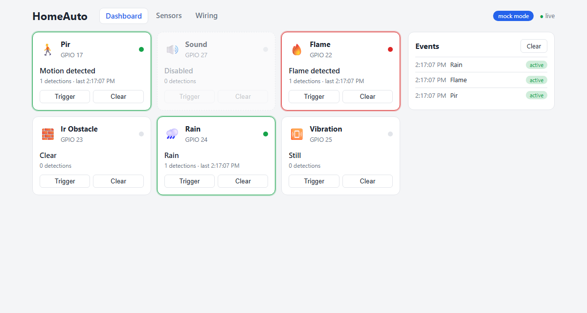
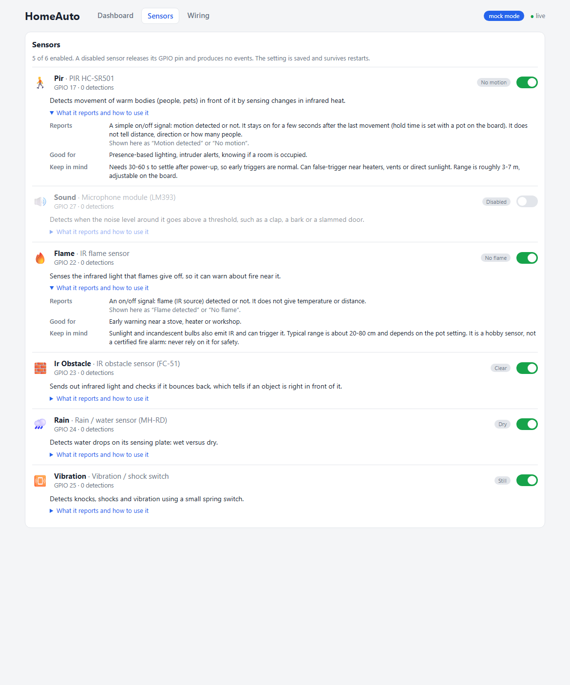
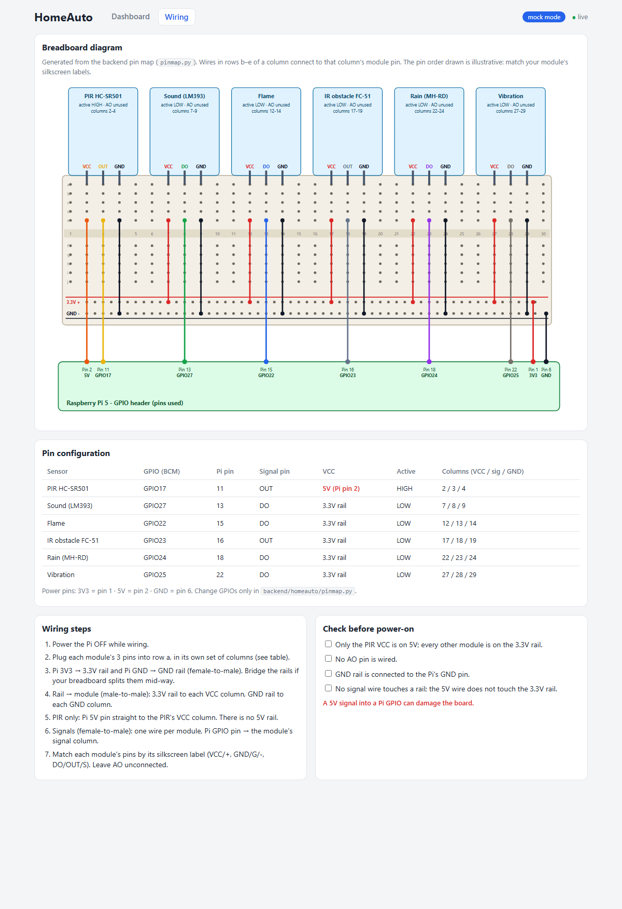
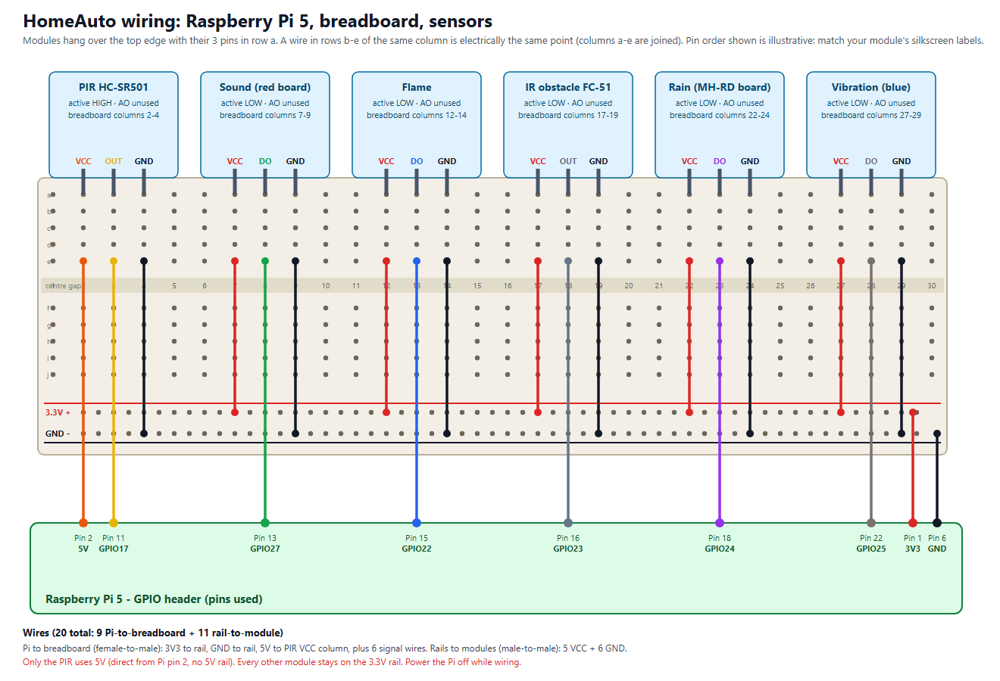

# HomeAuto

A modular smart-home system for the **Raspberry Pi 5**. A Python backend reads cheap Arduino-style
GPIO sensors, and a React dashboard shows them live, lets you switch them on and off, and shows you
exactly how to wire them.

Everything runs **without any hardware too** (mock mode), so you can develop and try the UI on a PC.



*(Screenshots are taken in mock mode.)*

## Features

- **Six sensor drivers:** PIR motion, sound, flame, IR obstacle, rain and vibration, built on one
  shared `DigitalSensor` base class (debounce, events, JSON snapshots).
- **Live dashboard:** sensor cards and an event log update instantly over a WebSocket, across all open tabs.
- **Sensors page:** enable or disable each sensor (saved, and it releases the GPIO pin), with a plain-language
  description of what each sensor reports, what it is good for, and its limits.
- **Wiring page:** a breadboard diagram, pin table, step list and a pre-power-on checklist, generated from
  the backend pin map so it never goes out of date.
- **Event history:** stored in SQLite, with a Clear button.
- **Mock mode:** fake GPIO with Trigger/Clear buttons on each card, no Raspberry Pi needed.
- **Tested without hardware:** the test suite uses gpiozero's mock pins.

| Sensors | Wiring |
|---|---|
|  |  |

## Quick start

**On Windows (mock GPIO, no hardware):**

```bat
runner.bat
```

It creates the Python environment and installs the frontend packages on first run, starts the backend
and the Vite dev server together in **one window** (both log there), and opens http://localhost:5173.
Stop with Ctrl+C (answer Y), or close the window.
Requires Python 3.11+ and Node.js.

**On the Raspberry Pi (real sensors):**

```bash
git clone https://github.com/wisosonic/HomeAuto.git
cd HomeAuto
sudo apt install python3-lgpio        # Pi 5 GPIO backend
chmod +x runner.sh
./runner.sh                           # add --mock to try it without wiring
```

It builds the UI if needed and serves the UI and the API together on port 8000 (open
`http://<pi-ip>:8000`). Node.js is needed on the Pi to build the UI; otherwise build on your PC
(`npm run build`) and copy `frontend/dist`. Other options: `--rebuild`, `PORT=8080 ./runner.sh`.

## Hardware

A Raspberry Pi 5, a breadboard, jumper wires and these modules:

| Sensor | Default GPIO (BCM) | Pi pin | Power |
|---|---|---|---|
| PIR HC-SR501 | 17 | 11 | **5V** (Pi pin 2) |
| Sound (LM393) | 27 | 13 | 3.3V |
| Flame | 22 | 15 | 3.3V |
| IR obstacle (FC-51) | 23 | 16 | 3.3V |
| Rain (MH-RD) | 24 | 18 | 3.3V |
| Vibration | 25 | 22 | 3.3V |

The full breadboard layout is in **[WIRING.md](WIRING.md)** (and on the Wiring page of the app):



> **Safety:** Pi GPIO is 3.3V and is **not 5V-tolerant**. Power every module from 3.3V except the PIR,
> and leave every `AO` (analog) pin unconnected, because the Pi has no analog input. No resistors or
> other parts are needed for these six sensors.

Change pins in one place: [backend/homeauto/pinmap.py](backend/homeauto/pinmap.py).

## Architecture

```
backend/homeauto/
  base.py        DigitalSensor: gpiozero wrapper, debounce, events, enable/disable
  sensors/       one small subclass per sensor
  pinmap.py      GPIO pin assignments (single source of truth)
  wiring.py      wiring data served to the Wiring page
  store.py       SQLite: event history + saved sensor settings
  hub.py         bridges GPIO threads to WebSocket clients
  api.py         FastAPI app: REST + /ws, serves the built UI
frontend/        React (Vite): dashboard, Sensors page, Wiring page
docs/            wiring diagram (generated) and screenshots
runner.bat       Windows launcher (mock mode, one window)
scripts/         helper scripts (stop-homeauto.ps1 frees a leftover backend on port 8000)
runner.sh        Raspberry Pi launcher
```

### API

| Method | Path | Purpose |
|---|---|---|
| GET | `/api/sensors`, `/api/sensors/{name}` | Sensor snapshots |
| PUT | `/api/sensors/{name}/enabled` | Enable or disable a sensor (saved) |
| GET | `/api/events?limit=&sensor=` | Event history, newest first |
| DELETE | `/api/events[?sensor=]` | Clear history |
| GET | `/api/wiring` | Pin map and breadboard layout |
| GET | `/api/info` | `{"mock": bool}` |
| POST | `/api/sensors/{name}/simulate` | Trigger a sensor (mock mode only) |
| WS | `/ws` | Live `snapshot`, `event`, `sensor_state`, `events_cleared` messages |

Interactive docs are at `/docs` when the backend is running.

### Configuration

| Variable | Default | Meaning |
|---|---|---|
| `HOMEAUTO_MOCK` | off | `1` = fake GPIO |
| `HOMEAUTO_DB` | `homeauto.db` | SQLite file |
| `HOMEAUTO_CORS` | `http://localhost:5173` | Allowed origins (comma-separated) |
| `HOMEAUTO_STATIC` | `frontend/dist` | Built UI folder to serve |

## Development

```bash
# backend (from backend/)
python -m venv .venv && .venv/Scripts/activate      # Linux: source .venv/bin/activate
pip install -r requirements-dev.txt
pytest                                              # no hardware needed
HOMEAUTO_MOCK=1 uvicorn homeauto.api:app --reload

# frontend (from frontend/)
npm install
npm run dev                                         # http://localhost:5173, proxies to :8000
```

To add a sensor, follow the checklist in [CLAUDE.md](CLAUDE.md). The Wiring page updates itself from the
backend.

## Status and limitations

- **Not yet verified on real hardware.** Sensor polarity (PIR is active-high; the others are assumed
  active-low) and debounce times are based on typical modules and may need tuning.
- **No authentication.** Anyone on your network can open the API and change settings, so use it on a trusted
  network only. Authentication comes before any actuator support.
- Event history grows without limit (no pruning yet).

## Roadmap

DS1302 real-time clock, laser module, LEDs (first actuators, which need control endpoints and authentication),
433 MHz transmitter/receiver, and the HC-SR04 ultrasonic sensor (needs a voltage divider).
