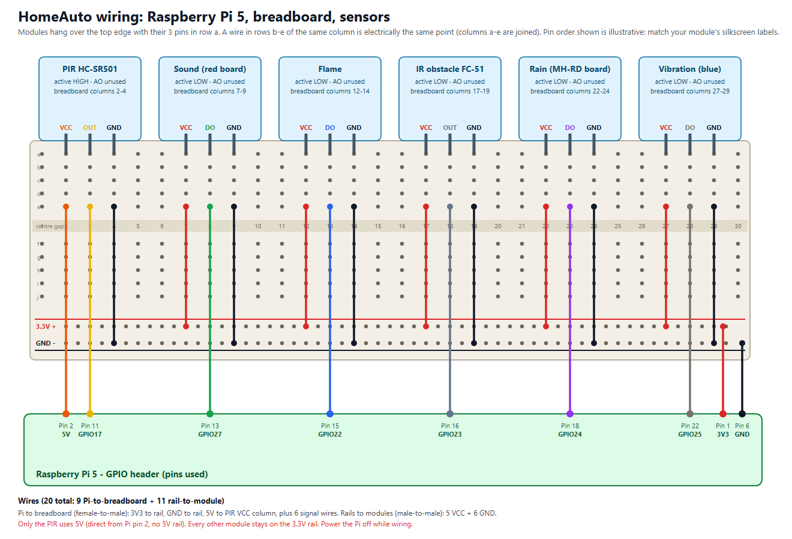

# Wiring guide: 6 digital sensors on Raspberry Pi 5

**Power the Pi OFF while wiring.** Change pins only in `backend/homeauto/pinmap.py`.

(Source: `docs/wiring.svg`, regenerate with `python docs/make_wiring.py`, which draws the
breadboard holes, columns and rails.)

## 1. Pi header pins used

| Pi physical pin | Name | Goes to |
|---|---|---|
| 1  | 3V3    | breadboard **3.3V rail (+)** |
| 2  | 5V     | **PIR VCC column** directly (no 5V rail) |
| 6  | GND    | breadboard **GND rail (-)** |
| 11 | GPIO17 | PIR signal |
| 13 | GPIO27 | Sound signal |
| 15 | GPIO22 | Flame signal |
| 16 | GPIO23 | IR obstacle signal |
| 18 | GPIO24 | Rain signal |
| 22 | GPIO25 | Vibration signal |

Run `pinout` on the Pi (comes with gpiozero) to see the header exactly as it sits on your board.

## 2. Breadboard layout

Each module's 3 pins plug into **row a** (the row nearest the edge), in 3 adjacent columns.
Every wire goes into the **same column**, any row b-e (columns a-e are joined electrically).

| Module | Breadboard columns (VCC, signal, GND) | VCC from | Signal from | GND from | Active |
|---|---|---|---|---|---|
| PIR HC-SR501 | 2, 3, 4 | **Pi pin 2 (5V)** | Pi pin 11 | GND rail | HIGH |
| Sound | 7, 8, 9 | 3.3V rail | Pi pin 13 | GND rail | LOW |
| Flame | 12, 13, 14 | 3.3V rail | Pi pin 15 | GND rail | LOW |
| IR obstacle FC-51 | 17, 18, 19 | 3.3V rail | Pi pin 16 | GND rail | LOW |
| Rain (MH-RD board) | 22, 23, 24 | 3.3V rail | Pi pin 18 | GND rail | LOW |
| Vibration | 27, 28, 29 | 3.3V rail | Pi pin 22 | GND rail | LOW |

The order VCC / signal / GND in the diagram is illustrative. **Match each module's pins by its
silkscreen label**, and swap the columns of the VCC, signal and GND wires accordingly.
Labels: `VCC`/`+` = power, `GND`/`G`/`-` = ground, `DO`/`OUT`/`D0`/`S` = digital signal.
**Leave `AO` unconnected** (the Pi has no analog input).

If the pins of your module are not in one row of 3 (e.g. the 4-pin rain and sound boards),
plug the 4 pins in 4 adjacent columns and leave AO's column empty of wires.

## 3. Steps

1. Plug each module into the breadboard (pins in row a).
2. Rails: Pi pin 1 -> 3.3V rail, Pi pin 6 -> GND rail (female-to-male). If your rails are split in
   the middle, bridge the two halves.
3. Rail to module (male-to-male): 5 wires from the 3.3V rail to the VCC columns of all modules
   except the PIR, and 6 wires from the GND rail to each GND column.
4. PIR power: Pi pin 2 (5V) straight to the PIR's VCC column (female-to-male).
5. Signals (female-to-male): one wire per module from its Pi pin to its signal column.
6. Rain: the plate connects to the small board by its 2 wires (already attached in your kit).

Suggested colours: red = 3.3V, orange = 5V, black = GND; signals yellow PIR, green sound, blue flame,
grey IR, purple rain, brown vibration.

## 4. Safety checks before powering on

- [ ] Only the PIR VCC is wired to 5V (Pi pin 2). Every other module is on the 3.3V rail.
      (A 5V module output into a GPIO can damage the Pi 5.)
- [ ] No `AO` pin is wired.
- [ ] GND rail is connected to Pi pin 6.
- [ ] No signal wire touches a rail, and the PIR's 5V wire does not touch the 3.3V rail.
- [ ] After first boot, adjust each module's blue potentiometer: the module's own LED lights
      when it detects something.

## 5. Not wired yet (later modules)

DS1302 RTC (3.3V), KY-008 laser, LEDs, 433 MHz TX/RX, HC-SR04 (needs resistors) and soil probe.
I2C (2, 3), SPI (7-11) and UART (14, 15) pins are intentionally left free.
